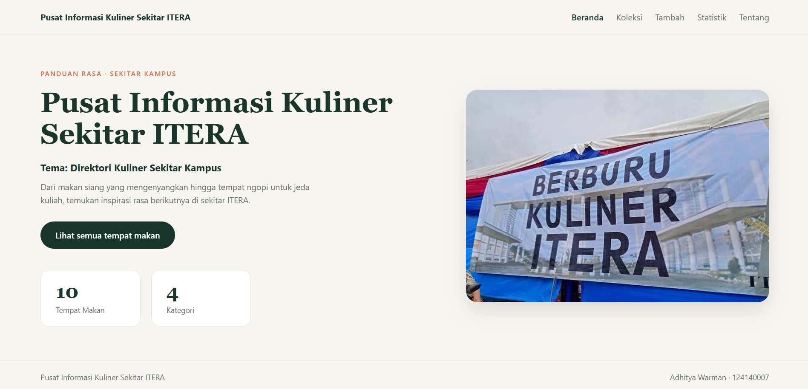

# Pusat Informasi Kuliner Sekitar ITERA

Nama: Adhitya Warman
NIM: 124140007
Kelas: RA
Tema: Direktori Kuliner Sekitar Kampus
Deployment: https://aw2606.github.io/uts-paw/



## Fitur

- Menampilkan ringkasan jumlah tempat makan dan jumlah kategori di halaman Beranda.
- Menampilkan daftar tempat makan di sekitar kampus ITERA yang dimuat dengan `fetch`.
- Pencarian berdasarkan judul tempat makan dan filter berdasarkan kategori.
- Halaman detail untuk melihat informasi lengkap tempat makan (Kategori, Alamat, Harga Rata-rata, Jam Buka) serta menghapus data.
- Form tambah tempat makan dengan validasi input judul dan penyimpanan otomatis ke `localStorage`.
- Halaman statistik berisi tabel jumlah tempat makan per kategori.

## Menjalankan secara lokal

```bash
cd app
npm install
npm run dev
```

## Konsep React yang dipakai

- Komponen fungsional dan props (`Layout`, `KartuItem`, `KotakPencarian`, `FilterKategori`, `RingkasanKoleksi`)
- State dan efek samping (`useState`, `useEffect`)
- Context API (`createContext`, `KoleksiProvider`, `useContext`)
- Custom Hook (`useLocalStorage`, `useKoleksi`)
- React Router (`Routes`, `Route`, `NavLink`, `Link`, `useParams`, `useNavigate`)
